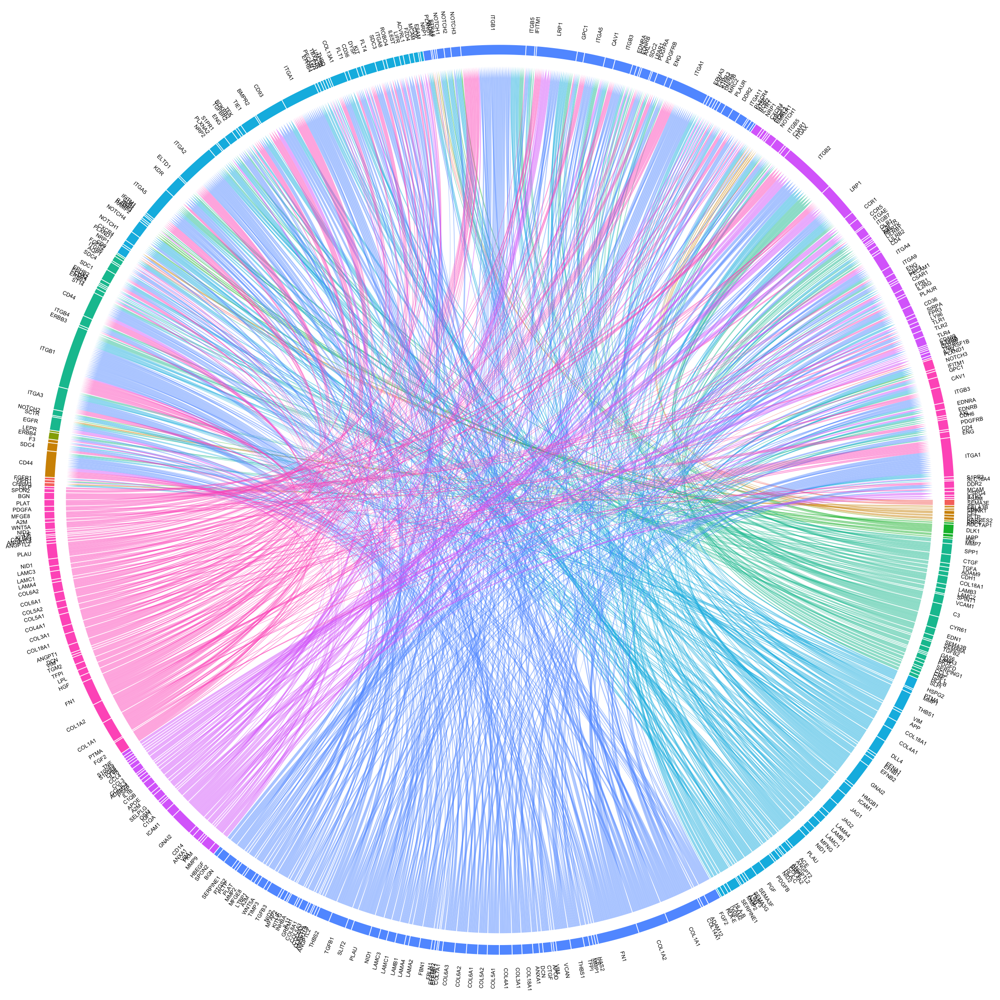

# Connectome 

## Computational Framework for Cell-Cell Communication Analysis in Single-Cell Transcriptomics

<!-- badges: start -->
[](https://zaoqu-liu.r-universe.dev/Connectome)
[](https://CRAN.R-project.org/package=Connectome)
[](https://www.gnu.org/licenses/gpl-3.0)
[](https://github.com/Zaoqu-Liu/Connectome)
<!-- badges: end -->

---

## Overview

**Connectome** is an R package designed for systematic inference and visualization of cell-cell communication networks from single-cell RNA sequencing (scRNA-seq) data. The package constructs *connectomic edgelists* representing intercellular signaling topologies based on ligand-receptor co-expression patterns across distinct cell populations.

The analytical framework integrates:

- **FANTOM5 ligand-receptor database** with multi-species support (human, mouse, rat, pig)
- **Statistical significance testing** via Wilcoxon rank-sum tests
- **Network centrality analysis** using Kleinberg hub and authority scores
- **Differential connectivity analysis** for comparative studies

---

## Citation

If you use Connectome in your research, please cite:

> Raredon, M.S.B., Yang, J., Garritano, J. *et al.* Computation and visualization of cell–cell signaling topologies in single-cell systems data using Connectome. *Scientific Reports* **12**, 4187 (2022). https://doi.org/10.1038/s41598-022-07959-x

**BibTeX:**
```bibtex
@article{raredon2022connectome,
  title={Computation and visualization of cell--cell signaling topologies in single-cell systems data using Connectome},
  author={Raredon, Micha Sam Brickman and Yang, Junchen and Garritano, James and others},
  journal={Scientific Reports},
  volume={12},
  pages={4187},
  year={2022},
  publisher={Nature Publishing Group},
  doi={10.1038/s41598-022-07959-x}
}
```

---

## Installation

### From R-universe (Recommended)

```r
install.packages("Connectome", repos = "https://zaoqu-liu.r-universe.dev")
```

### From GitHub

```r
if (!requireNamespace("remotes", quietly = TRUE))
    install.packages("remotes")
remotes::install_github("Zaoqu-Liu/Connectome")
```

### Dependencies

**Required Bioconductor packages:**

```r
if (!requireNamespace("BiocManager", quietly = TRUE))
    install.packages("BiocManager")
BiocManager::install(c("circlize", "ComplexHeatmap"))
```

---

## Quick Start

```r
library(Seurat)
library(Connectome)

# Ensure data is normalized and scaled
seurat_obj <- NormalizeData(seurat_obj)
seurat_obj <- ScaleData(seurat_obj)

# Construct connectome
connectome <- CreateConnectome(
  object = seurat_obj,
  species = "human",
  LR.database = "fantom5",
  min.cells.per.ident = 75,
  p.values = TRUE
)

# Apply biological filters
connectome_filtered <- FilterConnectome(
  connectome,
  min.pct = 0.1,      # Minimum expression fraction

  min.z = 0.25,       # Minimum z-score threshold
  max.p = 0.05        # Maximum adjusted p-value
)

# Visualize network topology
NetworkPlot(connectome_filtered)
CircosPlot(connectome_filtered)
```

---

## Core Functions

### Network Construction

| Function | Description |
|----------|-------------|
| `CreateConnectome()` | Construct connectomic edgelist from Seurat object |
| `FilterConnectome()` | Apply expression, significance, and topological filters |
| `DifferentialConnectome()` | Compute differential connectivity between conditions |
| `SingleCellConnectome()` | Generate single-cell resolution connectivity matrix |

### Visualization

| Function | Description |
|----------|-------------|
| `NetworkPlot()` | igraph-based directed network visualization |
| `CircosPlot()` | Chord diagram representation of connectivity |
| `CircosDiff()` | Differential connectivity chord diagram |
| `EdgeDotPlot()` | Dot plot matrix of edge weights |
| `DiffEdgeDotPlot()` | Differential edge visualization |

### Network Analysis

| Function | Description |
|----------|-------------|
| `Centrality()` | Hub and authority score analysis by signaling mode |
| `CompareCentrality()` | Cross-condition centrality comparison |
| `ModalDotPlot()` | Mode-stratified centrality visualization |
| `SignalScatter()` | Ligand-receptor co-expression scatter plot |

---
## Methodological Framework

### Edge Weight Computation

Connectome computes edge weights using ligand and receptor expression values:

$$w_{ij}^{LR} = f(E_i^L, E_j^R)$$

where $E_i^L$ denotes ligand expression in source population $i$, $E_j^R$ denotes receptor expression in target population $j$, and $f$ can be configured as:

- **Product**: $w = E^L \times E^R$ (default, captures co-expression)
- **Sum**: $w = E^L + E^R$ (additive contribution)
- **Mean**: $w = (E^L + E^R) / 2$ (average signal strength)

### Statistical Testing

Significance is assessed via Wilcoxon rank-sum tests comparing gene expression between each cluster and all other cells, with Bonferroni correction for multiple testing.

### Diagnostic Odds Ratio (DOR)

Gene specificity is quantified using the log-transformed Diagnostic Odds Ratio with Haldane-Anscombe correction:

$$\text{DOR} = \log\left(\frac{(TP + 0.5)(TN + 0.5)}{(FP + 0.5)(FN + 0.5)}\right)$$

---

## Supported Species

The package includes curated ligand-receptor databases from FANTOM5 for:

| Species | Dataset | Pairs |
|---------|---------|-------|
| Human | `ncomms8866_human` | 2,557 |
| Mouse | `ncomms8866_mouse` | ~2,400 |
| Rat | `ncomms8866_rat` | ~2,300 |
| Pig | `ncomms8866_pig` | ~2,200 |

Custom ligand-receptor databases can be supplied via the `custom.list` parameter.

---

## Integration with LIANA

Connectome is integrated with [LIANA](https://github.com/saezlab/liana) (Ligand-Receptor Analysis framework):

```r
library(liana)
liana_res <- liana_wrap(sce, method = "connectome")
```

---

## System Requirements

- **R version**: ≥ 4.0.0
- **Core dependencies**: Seurat (≥ 4.0.0), igraph, circlize, ComplexHeatmap
- **Memory**: Scales with dataset size; recommend 8+ GB RAM for large datasets
- **Platform**: Cross-platform (macOS, Linux, Windows)

---

## License

GPL-3.0 © 2022 Micha Sam Brickman Raredon, Zaoqu Liu

---

## References

1. Raredon, M.S.B., Yang, J., Garritano, J. *et al.* Computation and visualization of cell–cell signaling topologies in single-cell systems data using Connectome. *Sci Rep* **12**, 4187 (2022). [DOI: 10.1038/s41598-022-07959-x](https://doi.org/10.1038/s41598-022-07959-x)

2. Ramilowski, J.A. *et al.* A draft network of ligand–receptor-mediated multicellular signalling in human. *Nat Commun* **6**, 7866 (2015). [DOI: 10.1038/ncomms8866](https://doi.org/10.1038/ncomms8866)

3. Raredon, M.S.B. *et al.* Single-cell connectomic analysis of adult mammalian lungs. *Science Advances* **5**(12), eaaw3851 (2019). [DOI: 10.1126/sciadv.aaw3851](https://doi.org/10.1126/sciadv.aaw3851)

---

## Contact

- **Maintainer**: [Zaoqu Liu](https://github.com/Zaoqu-Liu) (liuzaoqu@163.com)
- **Original Author**: Micha Sam Brickman Raredon (Yale University)
- **Issues**: https://github.com/Zaoqu-Liu/Connectome/issues
