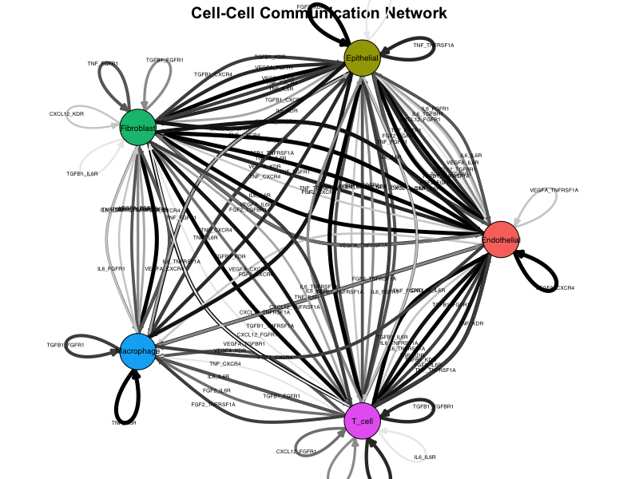
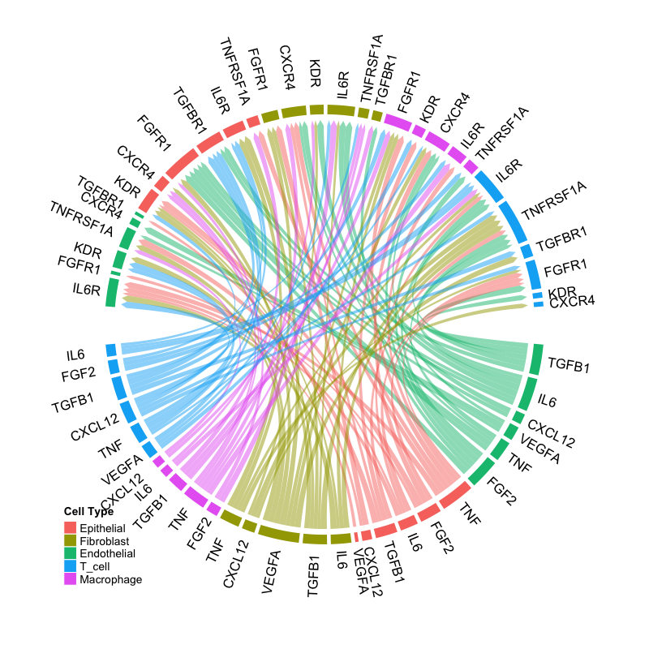
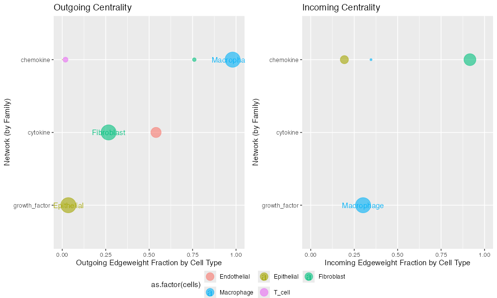

```{r setup, include = FALSE}
knitr::opts_chunk$set(
  collapse = TRUE,
  comment = "#>",
  fig.width = 7,
  fig.height = 5,
  warning = FALSE,
  message = FALSE
)
```

## Overview

**Connectome** is a computational framework for inferring and analyzing cell-cell communication networks from single-cell RNA sequencing (scRNA-seq) data. The package constructs *connectomic edgelists* that represent intercellular signaling topologies based on ligand-receptor co-expression patterns.

### Key Features

- **Multi-species support**: Human, mouse, rat, and pig via FANTOM5 database
- **Statistical rigor**: Wilcoxon rank-sum tests with multiple testing correction
- **Network analysis**: Kleinberg hub/authority scores for centrality analysis
- **Rich visualization**: Network plots, circos diagrams, dot plots
- **Differential analysis**: Compare connectivity between conditions

## Installation

### From R-universe (Recommended)

```{r eval=FALSE}
install.packages("Connectome", repos = "https://zaoqu-liu.r-universe.dev")
```

### From GitHub

```{r eval=FALSE}
remotes::install_github("Zaoqu-Liu/Connectome")
```

## Quick Start

### Load Required Packages

```{r eval=FALSE}
library(Seurat)
library(Connectome)
```

### Prepare Your Data

Connectome requires a Seurat object with:

1. **Normalized data** (`NormalizeData()`)
2. **Scaled data** (`ScaleData()`)
3. **Cell identity labels** (stored in `Idents()`)

```{r eval=FALSE}
# Example workflow
seurat_obj <- NormalizeData(seurat_obj)
seurat_obj <- ScaleData(seurat_obj)
Idents(seurat_obj) <- "cell_type"  # Set your cell type column
```

### Create Connectome

```{r eval=FALSE}
connectome <- CreateConnectome(
  object = seurat_obj,
  species = "human",
  LR.database = "fantom5",
  min.cells.per.ident = 50,
  p.values = TRUE
)
```

### Filter Edges

```{r eval=FALSE}
connectome_filtered <- FilterConnectome(
  connectome,
  min.pct = 0.1,       # Minimum expression fraction
  min.z = 0.25,        # Minimum z-score
  max.p = 0.05         # Maximum adjusted p-value
)
```

### Visualize Results

#### Network Plot

```{r network-example, eval=FALSE}
NetworkPlot(connectome_filtered)
```

```{r show-network, echo=FALSE, out.width="100%", fig.cap="Example network plot showing cell-cell communication topology."}

```

#### Circos Plot

```{r circos-example, eval=FALSE}
CircosPlot(connectome_filtered)
```

```{r show-circos, echo=FALSE, out.width="100%", fig.cap="Example circos plot showing ligand-receptor interactions."}

```

#### Centrality Analysis

```{r centrality-example, eval=FALSE}
Centrality(connectome_filtered)
```

```{r show-centrality, echo=FALSE, out.width="100%", fig.cap="Example centrality analysis showing hub and authority scores."}

```

## Understanding the Output

The connectome is a data.frame where each row represents a potential signaling edge:

| Column | Description |
|--------|-------------|
| `source` | Sending cell population |
| `target` | Receiving cell population |
| `ligand` | Ligand gene symbol |
| `receptor` | Receptor gene symbol |
| `pair` | Ligand-Receptor pair identifier |
| `mode` | Signaling family/category |
| `ligand.expression` | Log-normalized ligand expression |
| `recept.expression` | Log-normalized receptor expression |
| `ligand.scale` | Z-scored ligand expression |
| `recept.scale` | Z-scored receptor expression |
| `percent.source` | Fraction of source cells expressing ligand |
| `percent.target` | Fraction of target cells expressing receptor |
| `weight_norm` | Edge weight (normalized expression) |
| `weight_sc` | Edge weight (scaled expression) |
| `p_val_adj.lig` | Adjusted p-value for ligand |
| `p_val_adj.rec` | Adjusted p-value for receptor |

## Workflow Summary

```
┌─────────────────────────────────────────────────────────────┐
│                     Seurat Object                            │
│  (Normalized + Scaled + Cell Type Labels)                    │
└─────────────────────┬───────────────────────────────────────┘
                      │
                      ▼
┌─────────────────────────────────────────────────────────────┐
│               CreateConnectome()                             │
│  • Extract expression matrices                               │
│  • Match ligand-receptor pairs from FANTOM5                  │
│  • Calculate edge weights                                    │
│  • Compute statistical significance (optional)               │
└─────────────────────┬───────────────────────────────────────┘
                      │
                      ▼
┌─────────────────────────────────────────────────────────────┐
│               FilterConnectome()                             │
│  • Apply expression thresholds                               │
│  • Filter by significance                                    │
│  • Select signaling modes                                    │
└─────────────────────┬───────────────────────────────────────┘
                      │
          ┌───────────┴───────────┐
          ▼                       ▼
┌─────────────────────┐  ┌─────────────────────┐
│    Visualization    │  │      Analysis       │
│  • NetworkPlot()    │  │  • Centrality()     │
│  • CircosPlot()     │  │  • DOR()            │
│  • EdgeDotPlot()    │  │  • Differential     │
└─────────────────────┘  └─────────────────────┘
```

## Next Steps

- **[Algorithm Principles](algorithm.html)**: Mathematical framework and theory
- **[Visualization Gallery](visualization.html)**: Comprehensive visualization examples
- **[Differential Analysis](differential-analysis.html)**: Compare conditions
- **[Best Practices](best-practices.html)**: Troubleshooting and optimization

## Citation

If you use Connectome in your research, please cite:

> Raredon, M.S.B., Yang, J., Garritano, J. *et al.* Computation and visualization of cell–cell signaling topologies in single-cell systems data using Connectome. *Scientific Reports* **12**, 4187 (2022). https://doi.org/10.1038/s41598-022-07959-x

## Session Info

```{r}
sessionInfo()
```
