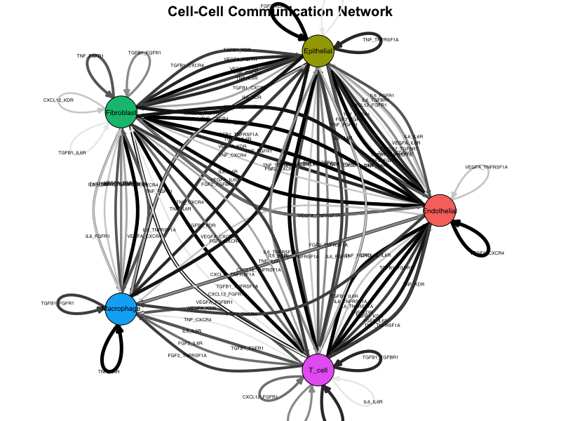
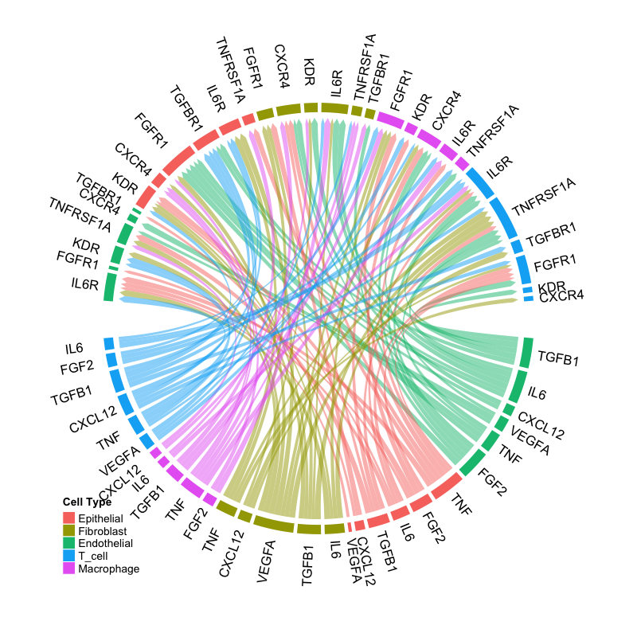
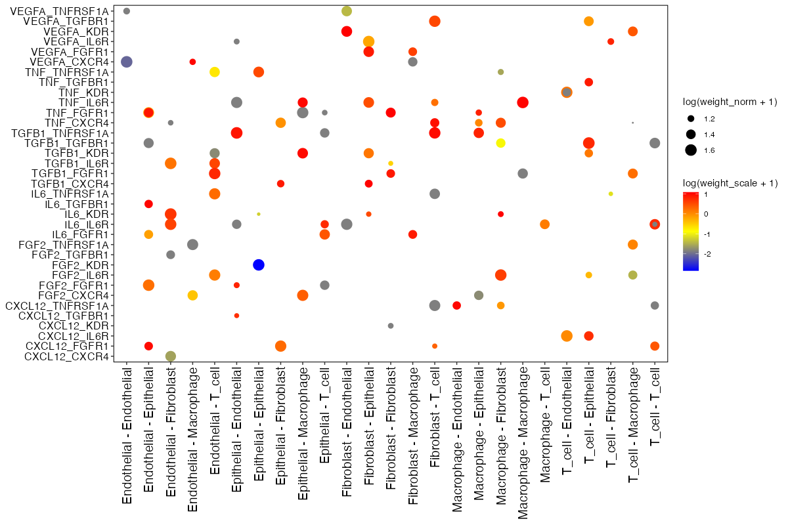
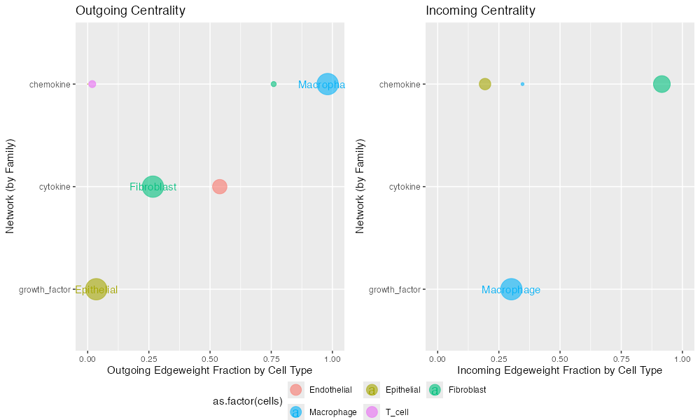
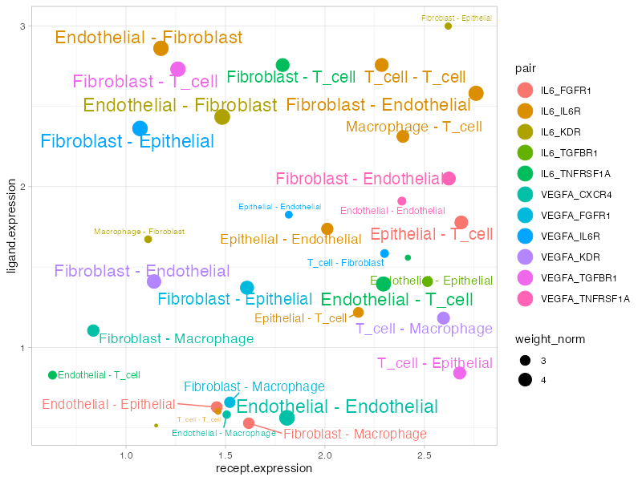

```{r setup, include = FALSE}
knitr::opts_chunk$set(
  collapse = TRUE,
  comment = "#>",
  fig.width = 8,
  fig.height = 6,
  warning = FALSE,
  message = FALSE
)
```

## Overview

Connectome provides a comprehensive suite of visualization functions for exploring cell-cell communication networks. This gallery demonstrates each visualization type with example outputs and interpretation guidelines.

## Example Data Preparation

All visualizations in this gallery use a mock connectome dataset for demonstration:

```{r mock-data, eval=FALSE}
library(Connectome)

# Create mock connectome for demonstration
set.seed(42)
cell_types <- c("Epithelial", "Fibroblast", "Macrophage", "T_cell", "Endothelial")
ligands <- c("VEGFA", "IL6", "TNF", "CXCL12", "FGF2", "TGFB1")
receptors <- c("KDR", "IL6R", "TNFRSF1A", "CXCR4", "FGFR1", "TGFBR1")
modes <- c("growth_factor", "cytokine", "cytokine", "chemokine", "growth_factor", "growth_factor")

n_edges <- 150
mock_connectome <- data.frame(
  source = sample(cell_types, n_edges, replace = TRUE),
  target = sample(cell_types, n_edges, replace = TRUE),
  ligand = sample(ligands, n_edges, replace = TRUE),
  receptor = sample(receptors, n_edges, replace = TRUE),
  mode = sample(modes, n_edges, replace = TRUE),
  ligand.expression = runif(n_edges, 0.5, 3),
  recept.expression = runif(n_edges, 0.5, 3),
  ligand.scale = rnorm(n_edges, 0, 1),
  recept.scale = rnorm(n_edges, 0, 1),
  percent.source = runif(n_edges, 0.1, 0.8),
  percent.target = runif(n_edges, 0.1, 0.8),
  weight_norm = runif(n_edges, 0.5, 5),
  weight_sc = runif(n_edges, -2, 2)
)
mock_connectome$pair <- paste(mock_connectome$ligand, mock_connectome$receptor, sep = "_")
mock_connectome$vector <- paste(mock_connectome$source, mock_connectome$target, sep = " - ")

# Filter for visualization
mock_filtered <- mock_connectome[mock_connectome$weight_norm > 2, ]
```

---

## Network Visualizations

### 1. NetworkPlot

The `NetworkPlot()` function creates an igraph-based directed network visualization where nodes represent cell populations and edges represent signaling interactions.

```{r network-code, eval=FALSE}
NetworkPlot(
  connectome_filtered,
  weight.attribute = "weight_norm",
  title = "Cell-Cell Communication Network"
)
```

```{r network-plot, echo=FALSE, out.width="100%", fig.cap="Network plot showing cell-cell communication. Nodes represent cell types, edges represent signaling interactions, and edge width is proportional to interaction strength."}

```

**Interpretation:**

- **Nodes**: Each node represents a cell population
- **Edges**: Directed arrows indicate signaling direction (sender → receiver)
- **Edge width**: Proportional to edge weight (interaction strength)
- **Edge color**: Gradient from light to dark based on weight
- **Layout**: Force-directed layout positions strongly connected nodes closer together

---

### 2. CircosPlot

Chord diagrams provide an elegant circular representation of connectivity patterns, ideal for visualizing complex multi-cellular communication networks.

```{r circos-code, eval=FALSE}
CircosPlot(
  connectome_filtered,
  weight.attribute = "weight_norm",
  lab.cex = 0.8
)
```

```{r circos-plot, echo=FALSE, out.width="100%", fig.cap="Circos plot showing ligand-receptor interactions. Sectors represent ligands (outer) and receptors (inner), with ribbons connecting interacting pairs."}

```

**Interpretation:**

- **Sectors**: Represent ligands and receptors grouped by signaling mode
- **Ribbons**: Connect ligand-receptor pairs with active interactions
- **Ribbon width**: Proportional to interaction strength
- **Colors**: Indicate source cell type or signaling mode

---

## Dot Plot Visualizations

### 3. EdgeDotPlot

Matrix visualization showing all edges meeting specified criteria, perfect for systematic comparison across cell-cell vectors.

```{r edge-code, eval=FALSE}
EdgeDotPlot(connectome_filtered)
```

```{r edge-dotplot, echo=FALSE, out.width="100%", fig.cap="Edge dot plot showing ligand-receptor pairs (y-axis) across cell-cell communication vectors (x-axis). Dot size represents normalized weight, color represents scaled weight."}

```

**Reading the plot:**

- **X-axis**: Cell-cell vectors (Source → Target)
- **Y-axis**: Ligand-Receptor pairs
- **Dot size**: log(weight_norm + 1) - larger dots indicate stronger interactions
- **Dot color**: log(weight_sc + 1) - color intensity reflects z-scored expression

---

## Centrality Analysis

### 4. Centrality

Hub and authority score analysis stratified by signaling mode, revealing which cell types are central senders or receivers in specific pathways.

```{r centrality-code, eval=FALSE}
Centrality(
  connectome_filtered,
  group.by = "mode",
  weight.attribute = "weight_sc"
)
```

```{r centrality-plot, echo=FALSE, out.width="100%", fig.cap="Centrality analysis showing hub scores (sending importance, left) and authority scores (receiving importance, right) for each cell type across signaling modes."}

```

**Interpretation:**

- **Hub score**: Measures importance as a signal sender
- **Authority score**: Measures importance as a signal receiver
- **Higher scores**: Indicate more central role in the signaling network
- **Mode stratification**: Allows comparison across different signaling families

---

## Scatter Plots

### 5. SignalScatter

Explore specific signaling mechanisms by visualizing ligand-receptor expression patterns across cell-cell vectors.

```{r scatter-code, eval=FALSE}
SignalScatter(
  connectome_filtered,
  features = c("VEGFA", "IL6"),
  weight.attribute = "weight_norm",
  label.threshold = 1.5
)
```

```{r signal-scatter, echo=FALSE, out.width="100%", fig.cap="Signal scatter plot showing expression patterns for selected ligands. Each point represents a cell-cell interaction vector, with position determined by ligand/receptor expression."}

```

**Plot elements:**

- **X-axis**: Receptor expression (scaled)
- **Y-axis**: Ligand expression (scaled)
- **Dot size**: Edge weight
- **Color**: Different ligand-receptor pairs
- **Labels**: Cell-cell vectors above threshold

---

## Customization Tips

### Color Palettes

```{r colors, eval=FALSE}
# Custom cell type colors
my_colors <- c(
  "Epithelial" = "#E41A1C",
  "Fibroblast" = "#377EB8", 
  "Macrophage" = "#4DAF4A",
  "T_cell" = "#984EA3",
  "Endothelial" = "#FF7F00"
)

NetworkPlot(connectome_filtered, cols.use = my_colors)
CircosPlot(connectome_filtered, cols.use = my_colors)
```

### Filtering Before Plotting

```{r filtering, eval=FALSE}
# Filter to specific interactions
conn_subset <- FilterConnectome(
  connectome,
  modes.include = c("growth_factor", "cytokine"),
  sources.include = c("Fibroblast", "Macrophage"),
  min.pct = 0.1,
  min.z = 0
)

NetworkPlot(conn_subset)
```

### Saving High-Quality Figures

```{r saving, eval=FALSE}
# PDF for publication
pdf("network_plot.pdf", width = 10, height = 8)
NetworkPlot(connectome_filtered)
dev.off()

# PNG for presentations
png("circos_plot.png", width = 1200, height = 1000, res = 150)
CircosPlot(connectome_filtered)
dev.off()
```

---

## Visualization Selection Guide

| Question | Recommended Plot |
|----------|------------------|
| Overall network topology | `NetworkPlot()` |
| Circular connectivity view | `CircosPlot()` |
| Edge details matrix | `EdgeDotPlot()` |
| Centrality by signaling mode | `Centrality()` |
| Specific gene interactions | `SignalScatter()` |
| Specific cell pair | `CellCellScatter()` |
| Compare conditions | `CompareCentrality()`, `CircosDiff()` |
| Differential analysis | `DiffEdgeDotPlot()`, `DifferentialScoringPlot()` |

---

## Session Info

```{r session}
sessionInfo()
```
